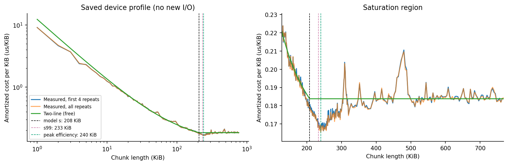
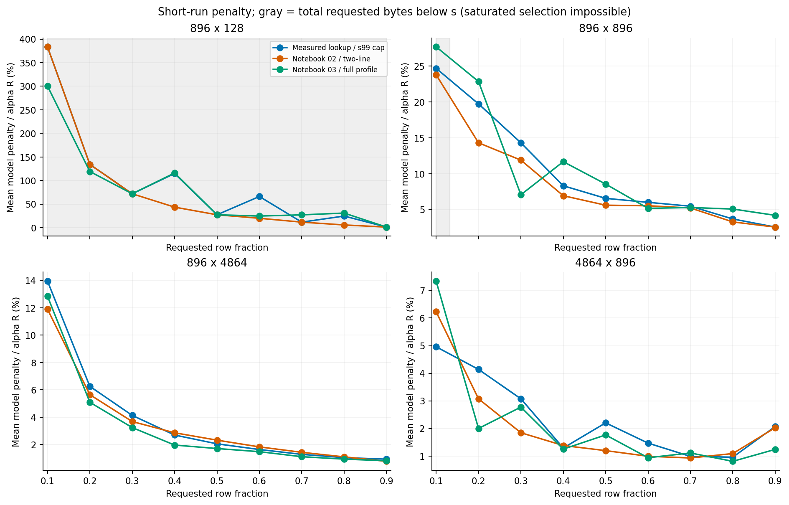
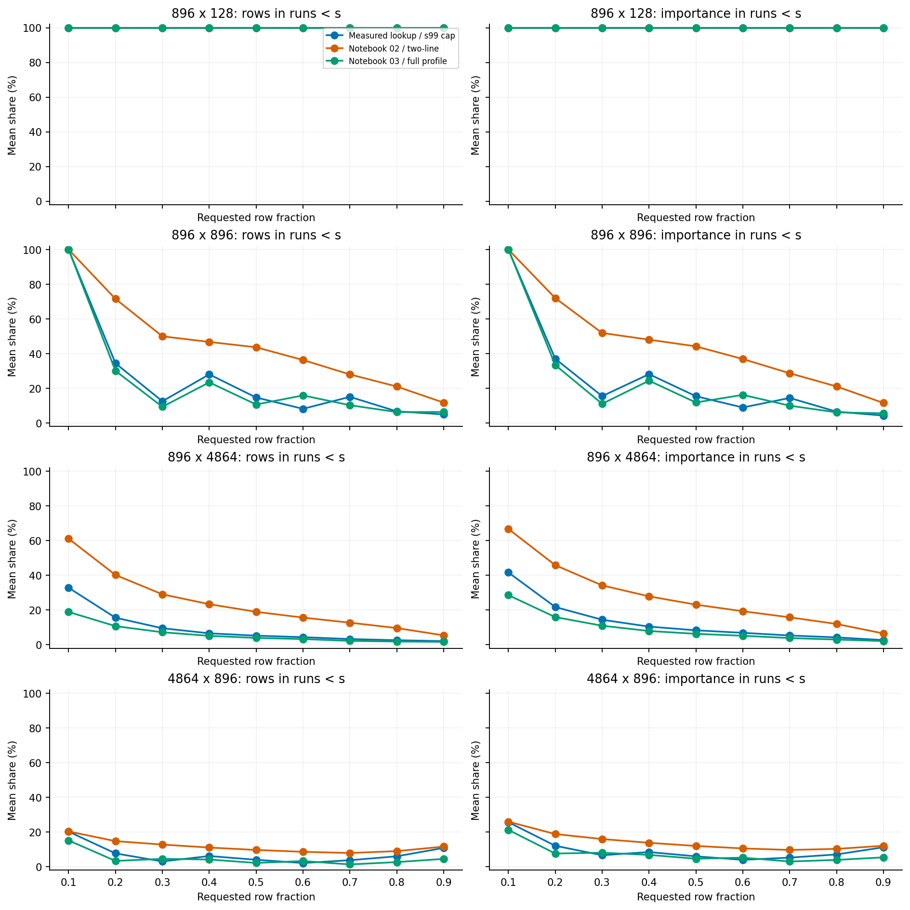
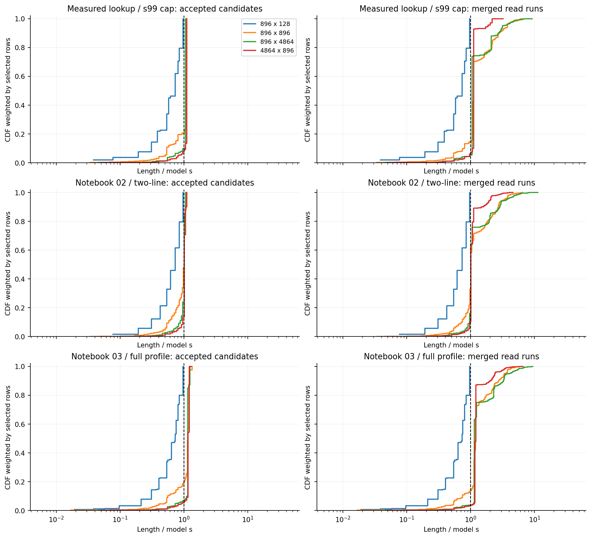
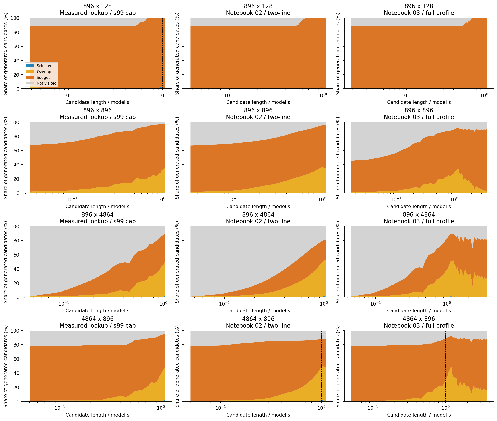
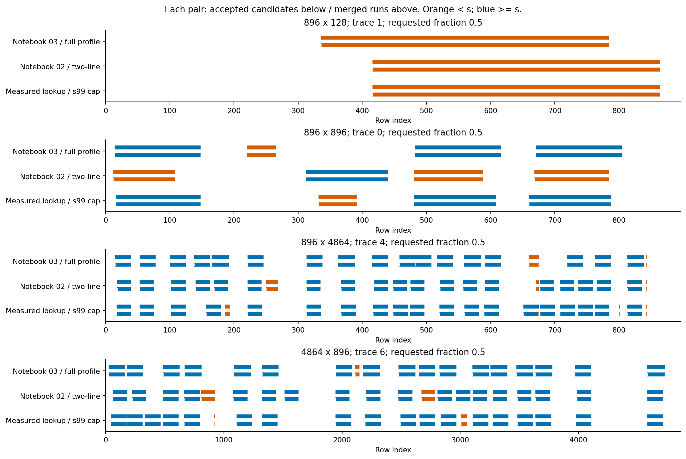

# Paper가 선택한 청크의 구조 진단

실행: 2026-10-24T21:23:28.031539+09:00 (Asia/Seoul). 기존 504개 trace × 9개 선택 비율 × 3개 설정 = **13,608사례**.

실측 lookup에 포화점 후보 상한을 적용한 주 대조군에서, 모든 청크를 포화 길이 이상으로 구성할 수 있는
3,096사례의 평균 짧은-run 페널티 p는 **5.17%**,
중앙값은 **2.63%**, 95백분위는 **16.01%**다.
짧은 run이 차지하는 선택 행 비중은 평균 **11.08%**다.
이는 모델로 환산한 구조 진단이며 새로운 읽기 지연시간 측정값이 아니다.

## 설정과 경계

- `paper_lookup_s99`: profile 앞 4회 반복 중앙값으로 후보 평가. 실험 02와 같은 후보 배치 및 s99 상한.
- `notebook02_twoline`: 현재 실험 02와 동일한 Two-line 비용과 후보 배치.
- `notebook03_full_lookup`: profile 전체 반복 중앙값, 실험 03에 저장된 튜닝값과 768 KiB 범위.
  이 설정은 논문의 포화점 후보 상한과 다르다. 이 실행은 504개 trace 및 비율 0.1–0.9를 사용했다.

모델 경계 s = **208 KiB**, s99 = **233 KiB**,
실측 peak-efficiency 경계 = **240 KiB**.
아래 주 통계는 s=208 KiB를 사용하며, `cases.csv`에 나머지 두 경계의 비중도 보존했다.
후보 최대 길이는 row 양자화 때문에 설정값과 다를 수 있다. 정확한 후보 길이는 `geometry.csv`에 있다.

## 최종 실제 읽기 청크

아래는 사례별 비중/페널티를 먼저 계산한 뒤 사례 사이에서 평균한 값이다. p의 정의는
`delta * sum(max(s - run_KiB, 0)) / (alpha * actual_selected_KiB)`이다.
청크 크기와 개수의 raw 합을 전체 trace에 바로 pooling한 통계와 구분한다.

모든 사례:

| 설정 | 사례 | 짧은 run의 행 비중 | 짧은 run의 중요도 비중 | 평균 p | p 중앙값 | p 95백분위 | p=0 사례 |
| --- | --- | --- | --- | --- | --- | --- | --- |
| paper_lookup_s99 | 4536 | 39.31% | 40.91% | 30.85% | 5.66% | 134.24% | 148 |
| notebook02_twoline | 4536 | 50.08% | 51.74% | 26.02% | 4.83% | 134.24% | 111 |
| notebook03_full_lookup | 4536 | 37.69% | 39.20% | 27.16% | 4.55% | 119.13% | 346 |

**총 선택량이 s 이상인 사례만**:

| 설정 | 사례 | 짧은 run의 행 비중 | 짧은 run의 중요도 비중 | 평균 p | p 중앙값 | p 95백분위 | p=0 사례 |
| --- | --- | --- | --- | --- | --- | --- | --- |
| paper_lookup_s99 | 3096 | 11.08% | 13.43% | 5.17% | 2.63% | 16.01% | 148 |
| notebook02_twoline | 3096 | 26.87% | 29.30% | 4.48% | 2.65% | 12.16% | 111 |
| notebook03_full_lookup | 3096 | 8.71% | 10.92% | 5.06% | 2.42% | 16.27% | 346 |

총 선택량 자체가 s보다 작으면 모든 청크를 s 이상으로 만드는 것은 불가능하다.
따라서 이 경우의 양의 p는 최소 청크 길이 제약의 실효성을 반박하는 근거로 쓸 수 없다.
특히 896 × 128 shape은 전체 가중치가 224 KiB라 0.1–0.9 예산에서 선택량이 모두 208 KiB보다 작다.
`cases.csv`에는 이를 구분하는 `saturated_feasible`과 `requested_saturated_feasible`을 기록했다.
또한 `fragmentation_over_minimum = L_model / T(total_selected_KiB) - 1`을 별도로 기록하여
낮은 예산의 불가피한 포화 미달 비용과 실제 분할 비용을 구분했다.

shape별, 포화 길이 구성이 가능한 사례:

| 설정 | shape | 가능 사례 | 평균 p | 짧은 run 행 비중 |
| --- | --- | --- | --- | --- |
| paper_lookup_s99 | 896 × 128 | 0 | 해당 없음 | 해당 없음 |
| paper_lookup_s99 | 896 × 896 | 1152 | 8.33% | 15.55% |
| paper_lookup_s99 | 896 × 4864 | 1296 | 3.78% | 9.14% |
| paper_lookup_s99 | 4864 × 896 | 648 | 2.35% | 7.00% |
| notebook02_twoline | 896 × 128 | 0 | 해당 없음 | 해당 없음 |
| notebook02_twoline | 896 × 896 | 1152 | 6.91% | 38.60% |
| notebook02_twoline | 896 × 4864 | 1296 | 3.51% | 24.04% |
| notebook02_twoline | 4864 × 896 | 648 | 2.08% | 11.65% |
| notebook03_full_lookup | 896 × 128 | 0 | 해당 없음 | 해당 없음 |
| notebook03_full_lookup | 896 × 896 | 1152 | 8.73% | 14.01% |
| notebook03_full_lookup | 896 × 4864 | 1296 | 3.25% | 6.11% |
| notebook03_full_lookup | 4864 × 896 | 648 | 2.14% | 4.48% |

## 채택 후보와 최종 run의 차이

| 설정 | 미충족 사례 | 평균 충족률 | 평균 채택 후보 수 | 평균 최종 run 수 | 평균 병합 감소율 |
| --- | --- | --- | --- | --- | --- |
| paper_lookup_s99 | 2520 | 98.112% | 10.63 | 9.30 | 6.67% |
| notebook02_twoline | 2520 | 98.112% | 10.98 | 9.53 | 6.59% |
| notebook03_full_lookup | 2232 | 99.213% | 9.80 | 8.55 | 6.05% |

채택한 후보가 인접하면 하나의 실제 읽기 run으로 합쳐진다. 후보 상한보다 긴 최종 run이 생길 수 있다.
`accepted_candidates.csv.gz`의 `merged_run_id`로 각 후보를 최종 run에 연결할 수 있다.
이 때문에 후보 길이 분포만으로 실제 읽기 페널티를 평가하면 잘못된 결론을 낼 수 있다.

위 CDF는 각 설정·shape 안에서 예산들을 합친 **선택 행 수 가중 분포**다.
세로선은 모델 s다. 큰 청크 하나가 담는 행 수를 반영하므로 청크 개수 가중 분포와 다르다.
`length_distribution.csv`에서 개수 및 중요도 가중 분포도 다시 만들 수 있다.

길이별 생성 후보를 분모로 선택·겹침 탈락·예산 탈락·미방문 비중을 표시한다.
원래 알고리즘 순서대로 예산 초과 여부를 먼저 검사하므로 예산 탈락 후보는 겹침 여부를 추가 분류하지 않는다.
예산을 채운 뒤 미방문한 후보는 평가 후 탈락한 후보와 구분한다.
`selection_rates_by_length.csv`에 생성 후보 기준 및 방문 후보 기준 선택률을 모두 저장했다.

총 선택량이 s 이상인 사례에서, 짧은 후보를 채택한 시점의 남은 예산도 집계했다.
남은 예산이 이미 s 미만이면 그 시점에는 포화 길이 후보를 추가로 선택할 수 없다.
단, 그 후보가 인접 구간에 합쳐지는지는 별도이며 이 통계만으로 짧은 최종 run의 원인을 단정하지 않는다.

| 설정 | 채택한 짧은 후보 수 | 선택 직전 남은 예산 < s | 비율 |
| --- | --- | --- | --- |
| paper_lookup_s99 | 9034 | 4051 | 44.84% |
| notebook02_twoline | 14875 | 3504 | 23.56% |
| notebook03_full_lookup | 7224 | 3778 | 52.30% |

예시는 shape별 첫 검증 trace의 예산 0.5를 사전에 고정해 선택했다. 성능이 좋은 사례를 골라내지 않았다.
각 쌍의 아래는 채택 후보, 위는 합쳐진 run이다. 주황은 s 미만, 파랑은 s 이상이다.

## 구현 검증

- 원래 upstream PyTorch 구현과 **216사례**에서 마스크 및 채택 후보 비용 합을 비교: **모두 일치**.
- **13,608사례 전체**에서 예산, 후보 합집합과 run 합집합,
  중요도 보존, 후보→run 연결, `L_model = alpha * actual_selected_KiB + delta * D_s`를 검증했다.
- stable sort 및 float32 점수 규칙을 유지했다. CPU 실행이며 선택 성능 벤치마크가 아니다.
- 입력/실험 코드/upstream 파일 SHA256와 commit은 `manifest.json`에 있다.

## 해석의 범위

이 실험이 직접 답하는 것은 Paper가 작은 구간을 얼마나 채택하고, 그 구간이 병합된 뒤 얼마나 남으며,
그 구조가 현재 비용 모델에서 얼마의 페널티를 발생시키는가이다.
짧은 청크를 금지했을 때 중요도가 얼마나 줄어드는지, tile의 경계 제약이 얼마나 손해인지,
실제 SSD 지연시간이 모델과 일치하는지는 이 실행에서 검증하지 않았다.
lookup 비용과 실제 whole-mask latency도 같다고 가정해서는 안 된다.

동일 trace의 여러 예산 및 같은 prompt에서 나온 여러 projection은 독립 표본이 아니다.
집계는 기술통계이며 독립 표본 기반 신뢰구간이나 유의성 주장을 하지 않는다.
데이터는 Qwen2.5-0.5B의 세 text prompt, 원래 행 순서의 activation trace다.
논문의 VLM 영상 입력·hot–cold reordering·정확도 평가를 재현한 결과는 아니다.

논문과의 대응: arXiv:2511.18692v1 §3.2/Algorithm 1의 선택 기준을 기록하고,
Figure 10/15의 길이 분포 분석에 포화점 정규화, 행/중요도 비중, 짧은-run 페널티,
후보 병합과 예산 미충족을 추가했다.
