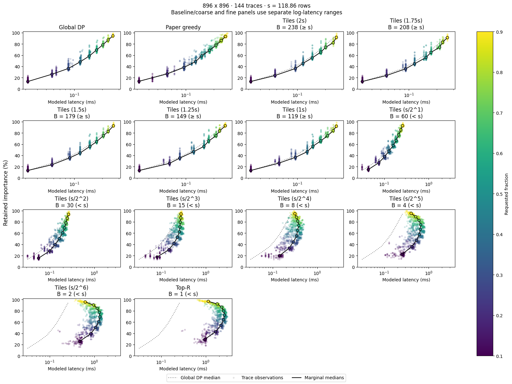
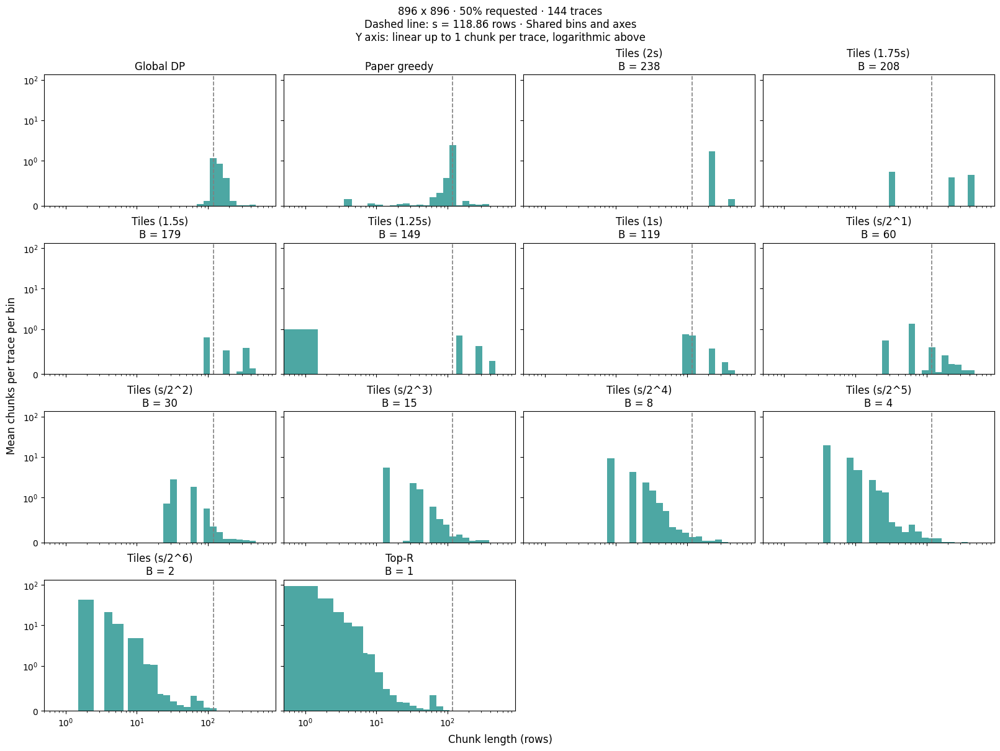

### 3.2 실험 02 — 비용 모델에서의 선택 알고리즘 비교

이번 실험에서는 3.1절에서 적합한 two-line 모델을 사용하여, Global DP, Paper, Tiles, Top-$R$의 보존 중요도와 추정 읽기 비용을 비교하였다. 2.3절의 Global DP를 고정 행 예산에서의 비율 최적해로 두고, 각 선택 방법이 이 기준에 얼마나 가까운지 살펴본다. 이 절의 지연시간은 비용 모델의 추정값이며, 행을 선택하는 계산 시간과 실제 SSD 읽기 시간은 3.3절에서 다룬다.

#### 3.2.1 입력 자료와 비용 모델

Qwen2.5-0.5B-Instruct에 세 개의 텍스트 입력을 주고, attention과 MLP의 projection에 들어가는 activation을 수집하였다. 입력은 연속적인 플래시 읽기, 신경망의 희소성과 정확도, 이동 평균 함수 작성을 각각 다룬다. 행을 제외하지 않은 forward에서 채널별 activation 절댓값의 평균을 구하고, 원래 채널 순서를 유지한 중요도 벡터를 trace로 저장하였다.

총 504개 trace를 사용하였다. 가중치는 원소당 2바이트이며, 입력 채널별 가중치를 한 행으로 배열했을 때 행 수를 $N$, 행당 원소 수를 $D$라 하자. Shape별 trace 수와 행 단위 전환점은 다음과 같다.

| $N\times D$ | Trace 수 | 한 행의 크기 (KiB) | 전환점 $\ell_0$ (행) |
| --- | ---: | ---: | ---: |
| $896\times128$ | 144 | 0.25 | 832.00 |
| $896\times896$ | 144 | 1.75 | 118.86 |
| $896\times4864$ | 144 | 9.50 | 21.89 |
| $4864\times896$ | 72 | 1.75 | 118.86 |

모든 방법에 3.1절의 전환점 208 KiB인 two-line 모델을 적용하였다. 행당 크기에 따라 계수와 전환점을 행 단위로 환산하고, 선택된 행들을 최대 연속 구간으로 합친 뒤 각 구간의 비용을 더하여 $L(M)$을 계산하였다. 3.1절에서 측정한 768 KiB보다 큰 구간에도 모델의 포화 이후 직선을 연장하여 적용하였다.

각 trace에서 요청 행 비율을 $f\in\{0.1,0.2,\ldots,0.9\}$로 바꾸며

$$
R=\max\{1,\lfloor fN\rfloor\}
$$

개의 행을 예산으로 주었다. 따라서 Global DP의 비교 기준은 총 $504\times9=4{,}536$개이다.

#### 3.2.2 비교 방법과 평가 지표

Global DP는 정확히 $R$개 행을 선택하면서 $I(M)/L(M)$을 최대화한다. 2.3절의 DP와 비율 갱신을 사용하며, 종료 허용오차는 $10^{-6}$으로 두었다. Top-$R$은 중요도가 가장 큰 $R$개 행을 선택한다.

Tiles는 2.4절의 두 배치와 잔여 구간 선택을 사용한다. 타일 길이는 전환점의 $1$, $1.25$, $1.5$, $1.75$, $2$배를 각각 올림한 값과, 전환점을 반복해서 절반으로 나눈 뒤 올림한 값들을 사용하였다. 같은 정수 길이는 한 번만 평가하고, $B=1$인 경우는 Top-$R$로 표시하였다.

Paper는 1.2절의 greedy 방법에 동일한 two-line 비용을 제공하였다. 후보 길이의 시작값과 증가 간격, 시작 위치의 이동 간격 상한은 각각 8 KiB로 설정하였다. $4864\times896$에서는 앞의 두 값을 12 KiB, 이동 간격 상한을 16 KiB로 두었다. 최대 후보 크기는 3.1절의 처리량 99% 도달 크기인 233 KiB를 기준으로 설정하였다.

Global DP, Tiles, Top-$R$은 예산을 모두 채우지만, Paper는 더 적은 행을 선택할 수 있다. 저장된 결과에서도 Paper는 4,536개 조건 중 2,520개에서 예산을 덜 사용하였다. 이후 비교는 같은 요청 예산에 대한 결과이며, 각 방법이 실제로 반환한 mask의 중요도와 비용을 사용한다. 정확히 $R$개 행을 선택하는 DP의 최적값이 예산을 덜 채운 Paper의 비율까지 항상 제한하는 것은 아니다.

보존 중요도는 전체 중요도에 대한 비율 $100I(M)/\sum_i v_i$로 나타내었다. DP 대비 비율은 같은 trace와 요청 예산에서 각 방법의 $I(M)/L(M)$을 DP의 비율로 나누어 백분율로 표시하였다. 표에서는 각 지표의 trace 간 중앙값을 사용한다. 특히 DP 대비 비율은 trace별로 먼저 나눈 뒤 중앙값을 구하므로, 중요도 중앙값과 지연시간 중앙값을 나눈 값과는 구분한다.

#### 3.2.3 중요도와 추정 읽기 비용

그림 3.2-1은 $896\times896$에서 요청 예산을 바꾸었을 때의 결과이다. 각 점은 하나의 trace이며, 같은 예산에서 중요도와 지연시간의 중앙값을 각각 구하여 연결하였다. 점선은 Global DP의 중앙값을 나타낸다. 이 곡선은 예산별 결과의 요약이며, 모든 중요도 수준에 대한 최소 지연시간 경계를 의미하지 않는다.

<figure style="width: 90%; max-width: 680px; margin: 1.1em auto; break-inside: avoid; page-break-inside: avoid;">
  
  <figcaption style="margin-top: 0.4em; font-size: 0.85em; line-height: 1.45; text-align: left;"><em>그림 3.2-1. 요청 행 비율에 따른 보존 중요도와 two-line 추정 읽기 비용. 색은 요청 비율을 나타내며, 그림의 s는 행 단위 전환점이다. Baseline/coarse와 fine 패널은 서로 다른 가로축 범위를 사용하고, 가로축은 로그 척도이다.</em></figcaption>
</figure>

요청 비율이 50%일 때는 $R=448$이다. 이 예산에서 네 방법의 결과를 정리하면 다음과 같다. Tiles는 $B=\lceil\ell_0\rceil=119$인 설정을 사용하였다.

| 방법 | 보존 중요도 (%) | 추정 읽기 비용 (ms) | DP 대비 비율 (%) |
| --- | ---: | ---: | ---: |
| Global DP | 58.44 | 0.1441 | 100.00 |
| Paper | 58.97 | 0.1483 | 96.82 |
| Tiles ($B=119$) | 56.32 | 0.1470 | 95.87 |
| Top-$R$ | 72.48 | 2.6400 | 7.22 |

Top-$R$은 중요도를 가장 많이 보존하지만, 추정 읽기 비용도 크게 나타났다. 반면 Tiles는 일부 중요도를 포기하면서 읽기 비용을 DP에 가까운 수준으로 낮추었다. 이 조건에서 Tiles의 DP 대비 비율 중앙값은 95.87%였다. Paper는 Tiles보다 중요도를 더 많이 보존하고 읽기 비용도 조금 높았으며, 비율 중앙값은 96.82%로 Tiles보다 높았다.

같은 50% 예산에서 다른 shape의 결과도 비교하였다. 아래 표에서 Tiles의 길이는 각 shape의 $B=\lceil\ell_0\rceil$이다.

| $N\times D$ | Paper의 DP 대비 비율 (%) | Tiles의 DP 대비 비율 (%) | Top-$R$의 DP 대비 비율 (%) |
| --- | ---: | ---: | ---: |
| $896\times128$ | 99.72 | 100.00 | 1.30 |
| $896\times896$ | 96.82 | 95.87 | 7.22 |
| $896\times4864$ | 97.51 | 95.78 | 26.60 |
| $4864\times896$ | 98.68 | 96.46 | 6.10 |

$896\times128$을 제외한 세 shape에서 Tiles는 DP 비율의 약 95.8–96.5%를 중앙값으로 달성하였다. 이 수치는 해당 예산과 trace에서 관찰한 결과이며, 2.5절의 중요도 보존율에 따른 보장과는 구분한다. 또한 이 예산에서는 세 shape 모두 Paper의 비율 중앙값이 Tiles보다 높았다. 선택 계산 비용까지 포함했을 때의 관계는 3.3절에서 확인한다.

#### 3.2.4 구간 길이와 타일 크기의 영향

그림 3.2-2는 같은 $896\times896$, 50% 예산에서 선택된 최대 연속 구간의 길이 분포이다. 인접한 타일은 하나의 구간으로 합쳐지므로, 가로축의 구간 길이는 타일 길이와 반드시 같지는 않다. 각 구간의 빈도는 전체 trace 수로 나누어, trace당 평균 구간 수로 나타내었다.

<figure style="width: 90%; max-width: 680px; margin: 1.1em auto; break-inside: avoid; page-break-inside: avoid;">
  
  <figcaption style="margin-top: 0.4em; font-size: 0.85em; line-height: 1.45; text-align: left;"><em>그림 3.2-2. 방법별 최대 연속 구간의 길이 분포. 점선은 전환점 118.86행을 나타낸다. 가로축은 로그 척도이며, 세로축은 trace당 구간 수 1까지 선형, 그 이상은 로그 척도이다.</em></figcaption>
</figure>

Top-$R$의 구간은 주로 짧은 길이에 분포한다. Trace별 구간 수의 중앙값은 Top-$R$에서 208개, Global DP와 $B=119$인 Tiles에서 각각 3개였다. 2.2절의 비용 분해에 따르면, 같은 $R$에서 이 차이는 짧은 구간에 부과되는 추가 비용으로 이어진다.

타일을 작게 하면 중요도가 높은 행들을 더 세밀하게 선택할 수 있지만, 포화 길이에 못 미치는 구간도 늘어날 수 있다. 예를 들어 $B=119$에서 $B=30$으로 줄이면 보존 중요도의 중앙값은 56.32%에서 60.61%로 증가하지만, 읽기 비용은 0.1470 ms에서 0.1958 ms로 증가하였다. DP 대비 비율 중앙값은 95.87%에서 75.69%로 낮아졌다. 반대로 타일을 크게 하면 선택 위치의 자유도가 줄고 잔여 예산도 달라지므로, 타일 크기에 따라 비율이 한 방향으로만 변하지는 않았다.

$896\times128$은 별도로 해석할 필요가 있다. 행렬 전체는 224 KiB로 two-line 전환점 208 KiB보다 조금 크지만, 실험의 최대 선택 예산은 806행, 즉 201.5 KiB이다. 따라서 모든 요청 예산이 $R<\ell_0=832$를 만족한다. 전체 크기는 처리량 99% 도달 크기인 233 KiB보다도 작다.

이 shape에서 $B=\lceil\ell_0\rceil$인 Tiles는 항상 $R<B$이므로, 중요도가 가장 큰 길이 $R$의 단일 구간을 선택한다. 저장된 DP 결과도 모든 trace와 예산에서 같은 중요도와 비용의 단일 구간 해를 반환하였다. 따라서 앞 표의 100%는 포화 길이의 타일 여러 개를 선택한 결과가 아니라, 선택 예산이 전환점보다 작은 조건에서 단일 구간 선택이 DP와 일치한 결과이다. $896\times896$에서도 10% 예산은 $R=89<\ell_0$에 해당하지만, 나머지 예산에서는 전환점보다 많은 행을 선택한다.

이번 비교에서는 전환점 부근의 타일을 사용하여 짧은 구간의 추가 비용을 줄이는 효과를 확인하였다. 이 결과는 two-line 비용 모델과 수집한 중요도 trace에 대한 것이며, 실제 읽기 시간에서의 효과는 다음 실험에서 살펴본다.

<!--
작성 근거: 기존 노트북의 코드와 저장된 결과를 읽어 작성하였으며 실험은 재실행하지 않았다.
입력 수집: ../../final/results/02/02_01_capture_traces.ipynb
비율 최적해: ../../final/results/02/02_02_global_oracle.ipynb
선택 방법과 설정: ../../final/results/02/02_03_selector_sweep.ipynb
그림 3.2-1: ../../final/results/02/02_04_analyze_oracle.ipynb, cells[16].outputs[1].data[image/png]
그림 3.2-2: ../../final/results/02/02_05_chunk_lengths.ipynb, cells[18].outputs[1].data[image/png], FRACTION = 0.5
두 PNG는 저장된 출력에서 그대로 추출하였다.
표와 본문의 수치: ../../final/results/02/oracle_reference.csv 및 selector_results.csv
보존 중요도 = 100 * importance / importance_total.
DP 대비 비율 = 100 * (importance / latency) / (DP importance / DP latency).
DP 결과는 trace_id와 fraction으로 대응시키고, shape·방법·예산별 중앙값을 구하였다.
구간 수는 intervals의 길이, 선택 행 수는 각 [start, end) 구간의 end - start 합이다.
-->
