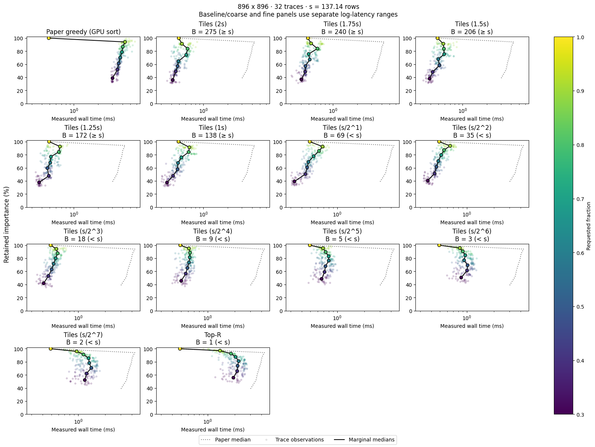
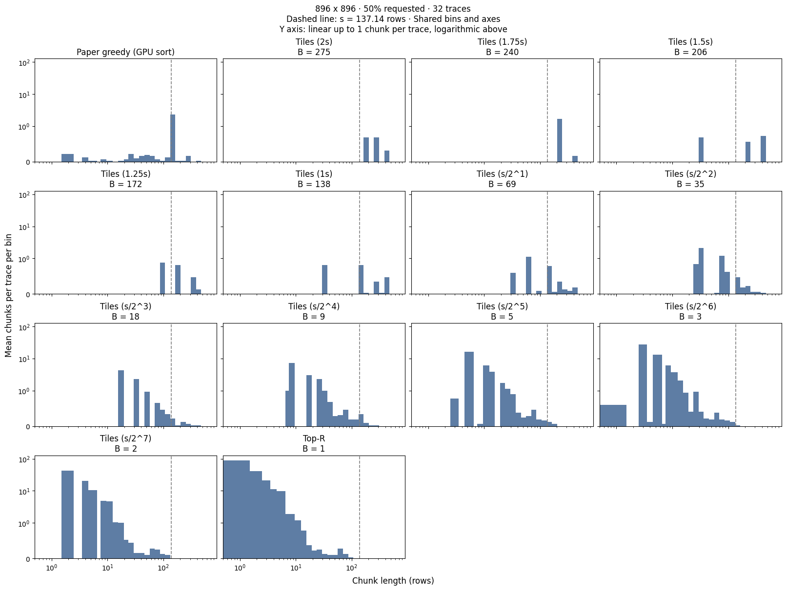

### 3.3 실험 03 — 실제 선택 시간과 SSD 읽기 시간 비교

이번 실험에서는 Paper, Tiles, Top-$R$을 실제로 실행하고, 선택한 행들을 SSD에 저장한 blob에서 읽는 시간을 측정하였다. 3.2절에서 살펴본 중요도–비용 관계가 실제 읽기에서도 나타나는지, 행을 선택하는 계산 시간을 포함하면 방법 간 차이가 어떻게 달라지는지 살펴본다. Global DP는 이번 실측 비교에 포함하지 않았다.

#### 3.3.1 측정 설정과 시간의 범위

3.2절의 중요도 자료에서 shape별로 저장 순서상 균등한 간격의 32개 trace를 골라, 총 128개를 사용하였다. 요청 행 비율은 30–100%에서 10% 간격으로 바꾸었다. 행 예산은 앞 절과 같이 $R=\max\{1,\lfloor fN\rfloor\}$로 정하였다.

행마다 실제 가중치와 같은 바이트 수를 갖도록 파일의 행을 해석하고, 선택한 행 위치에 해당하는 데이터를 읽었다. 파일은 임의 바이트로 채운 8,512 KiB 크기의 blob이며, 모든 projection을 담을 수 있는 최대 크기로 한 번 생성하였다. 측정 전에 파일을 디스크에 기록하고 flush와 fsync를 수행하였다. 실제 모델 가중치를 사용한 추론은 이 측정에 포함하지 않는다.

저장된 환경 기록에서 파일은 NVMe SSD의 Btrfs 파일시스템에 위치한다. Reader는 최대 6개 스레드와 O_DIRECT를 사용하고, 연속 구간이 768 KiB를 넘으면 여러 읽기 요청으로 나누었다. O_DIRECT 정렬 조건에 맞지 않는 요청은 정렬된 범위를 읽은 뒤 필요한 바이트를 복사하였다. Torch의 CPU 스레드 수는 1로 두었으며, Paper의 정렬에는 CUDA를 사용하였다.

각 trace와 예산에서 매 반복마다 방법의 실행 순서를 무작위로 섞었다. 3회 warmup을 제외하고 30회 측정하였으며, 총 14,080개 조건에 대해 422,400개의 반복 측정값을 저장하였다. 매 반복에서 mask를 다시 계산한 뒤 읽기를 수행하였다. 예외적으로 $R=N$이면 모든 방법이 선택 계산을 생략하고 전체 행을 읽는다.

측정 시간은 다음과 같이 구분하였다.

| 지표 | 측정 범위 |
| --- | --- |
| `selection_ms` | 준비된 CPU 중요도에서 mask를 구성하는 시간. Paper의 후보 점수 계산, GPU 정렬과 점수·정렬 인덱스 전송을 포함한다. |
| `io_ms` | Native reader 내부의 스레드 생성부터 읽기 완료와 스레드 회수까지의 시간. 정렬 버퍼가 필요한 경우 그 복사도 포함한다. |
| `wall_ms` | 선택 시작부터 읽기가 완료되어 CPU tensor를 반환할 때까지의 전체 시간. 읽기 요청과 버퍼 준비, 파일 열기·닫기 등의 비용도 포함한다. |

비용 표와 후보 길이 설정은 측정 전에 준비하였다. 중요도 수집, native 코드의 컴파일, 읽은 가중치의 GPU 전송, 모델 계산은 측정 범위에 포함하지 않았다. O_DIRECT 사용 여부와 반환 mask·tensor 크기의 검사는 시간 측정 후 수행하였다.

각 조건에서는 30회 반복의 중앙값을 먼저 구하였다. 이후 같은 shape·방법·예산에 속하는 32개 trace의 중앙값으로 결과를 요약하였다. 전체 시간은 별도로 측정하였으며, 선택 시간과 읽기 시간의 중앙값을 더하여 구하지 않았다.

#### 3.3.2 선택 방법의 설정

이번 실험에서는 선택에 필요한 비용을 3.1절의 실측 비용 표에서 가져왔다. 크기별 7회 측정의 중앙값을 사용하고, 측정점 사이의 크기는 선형 보간하였다. 1 KiB보다 작은 요청에는 최소 측정 크기의 비용을 적용하고, 768 KiB보다 큰 요청은 마지막 측정점의 비용을 크기에 비례하여 연장하였다. 따라서 3.2절의 two-line 근사를 사용해 만든 mask를 그대로 읽는 실험과는 구분한다.

Tiles의 기준 크기는 측정된 크기 중 KiB당 읽기 비용이 가장 작은 240 KiB로 정하였다. 한 행의 크기가 $w$ KiB이면 기준 행 수는 $s=240/w$이다. 이 값은 3.2절에서 사용한 two-line 전환점 $\ell_0=208/w$와 다르다. 기준의 $1$, $1.25$, $1.5$, $1.75$, $2$배와 반복해서 절반으로 나눈 값들을 각각 올림하여 타일 길이로 사용하였다. 같은 정수 길이는 한 번만 평가하고, 길이 1은 Top-$R$로 표시하였다.

Tiles는 CPU의 C++ 구현으로 두 배치와 잔여 구간을 평가한다. 두 mask의 비율을 비교할 때도 위 비용 표를 사용하였다. Paper는 CPU에서 후보 점수를 계산하고 GPU에서 정렬한 뒤, 정렬 순서를 CPU로 가져와 겹침과 잔여 예산을 검사한다.

Paper의 후보 설정은 별도로 튜닝하였다. 최소 후보 크기와 이동 간격 상한을 4–64 KiB에서 4 KiB 간격으로 탐색하고, 동일한 행 단위 설정은 한 번만 평가하였다. 난수 중요도와 약 90% 행 예산에서 1회 warmup 후 30회 선택 시간의 중앙값을 구하였다. 1.6 ms 이하인 설정을 우선하여 최소 크기와 이동 간격 상한의 합이 가장 작은 것을 선택하고, 없으면 2 ms 이하인 설정을 사용하였다. 이 기준도 만족하지 못하면 가장 빠른 설정을 선택하도록 하였다. 튜닝 시간은 소수 셋째 자리까지 반올림하여 비교하였다.

실측에 사용한 최종 설정은 다음과 같다. 최소 후보 크기는 길이 증가 간격으로도 사용하였으며, 후보 최대 크기는 측정 범위의 끝인 768 KiB를 기준으로 정하였다.

| $N\times D$ | Paper 최소 크기·증가 간격 (KiB) | Paper 이동 간격 상한 (KiB) | Tiles 기준 길이 $\lceil s\rceil$ (행) |
| --- | ---: | ---: | ---: |
| $896\times128$ | 4 | 4 | 960 |
| $896\times896$ | 4 | 4 | 138 |
| $896\times4864$ | 4 | 4 | 26 |
| $4864\times896$ | 8 | 16 | 138 |

튜닝과 본 측정은 입력 중요도와 호출 경로가 다르므로, 튜닝의 시간 기준이 본 측정의 `selection_ms` 상한을 보장하지는 않는다. Paper는 이번에도 예산을 모두 채우지 않을 수 있다. 비교는 동일한 trace와 요청 예산을 기준으로 수행하고, 중요도는 각 방법이 반환한 mask에서 계산하였다.

#### 3.3.3 보존 중요도와 실제 실행 시간

그림 3.3-1은 $896\times896$에서의 보존 중요도와 전체 시간 `wall_ms`를 보여준다. 각 점은 하나의 trace이며, 실선은 요청 예산별 중요도와 전체 시간의 중앙값을 각각 연결한 것이다. 점선은 Paper의 결과이다.

<figure style="width: 90%; max-width: 680px; margin: 1.1em auto; break-inside: avoid; page-break-inside: avoid;">
  
  <figcaption style="margin-top: 0.4em; font-size: 0.85em; line-height: 1.45; text-align: left;"><em>그림 3.3-1. 요청 행 비율에 따른 보존 중요도와 실측 전체 시간. 색은 요청 비율을 나타내며, 그림의 s는 240 KiB를 행 단위로 환산한 기준이다. Baseline/coarse와 fine 패널은 서로 다른 로그 가로축 범위를 사용한다.</em></figcaption>
</figure>

100% 예산에서는 모든 방법이 선택 계산을 생략하므로, 그림에서 해당 점의 전체 시간이 앞선 예산보다 짧아질 수 있다. 특히 Paper의 곡선이 마지막 점에서 왼쪽으로 이동하는 것은 이 처리에 따른 결과이다. 예산별 중앙값을 연결한 곡선은 모든 중요도 수준에 대한 최소 실행 시간 경계를 의미하지 않는다.

50% 예산인 $R=448$에서 선택 시간과 읽기 시간을 나누어 보면 다음과 같다. Tiles는 기준 길이 $B=138$을 사용하였다. 각 열은 독립적으로 구한 중앙값이다.

| 방법 | 보존 중요도 (%) | 선택 시간 (ms) | 읽기 시간 (ms) | 전체 시간 (ms) |
| --- | ---: | ---: | ---: | ---: |
| Paper | 61.36 | 3.0433 | 0.4753 | 3.5917 |
| Tiles ($B=138$) | 57.74 | 0.0133 | 0.4305 | 0.4779 |
| Top-$R$ | 74.02 | 0.0471 | 2.0724 | 2.1621 |

Tiles는 Paper보다 중요도를 적게 보존했지만, 읽기 시간과 선택 시간 모두 작았다. 특히 전체 시간의 차이에서 선택 계산이 큰 비중을 차지하였다. Top-$R$은 중요도를 가장 많이 보존하고 선택 시간도 짧았지만, 읽기 시간이 Tiles보다 길었다. 한편 이 조건에서 Top-$R$의 전체 시간은 Paper보다 짧았다. 읽기만 비교할 때와 선택 계산까지 포함할 때의 관계가 달라진 것이다.

Shape별 차이를 보기 위해, 같은 trace와 요청 예산에서 Tiles의 측정값에서 Paper의 측정값을 뺀 뒤 중앙값을 구하였다. 아래 표의 Tiles는 각 shape의 $B=\lceil s\rceil$이며, 100% 예산을 포함한 32개 trace와 8개 예산의 256쌍을 사용하였다. 시간의 음수는 Tiles가 더 짧다는 뜻이며, 중요도 차이의 단위는 퍼센트포인트이다.

| $N\times D$ | 중요도 차이 (pp) | 선택 시간 차이 (ms) | 읽기 시간 차이 (ms) | 전체 시간 차이 (ms) |
| --- | ---: | ---: | ---: | ---: |
| $896\times128$ | +0.5203 | −0.5688 | −0.0036 | −0.5762 |
| $896\times896$ | −1.8209 | −3.0794 | −0.0413 | −3.1385 |
| $896\times4864$ | −1.1106 | −3.0446 | +0.0019 | −3.0695 |
| $4864\times896$ | −0.7719 | −2.4379 | +0.0947 | −2.3568 |

전체 시간 차이의 중앙값은 모든 shape에서 음수였다. 그러나 읽기 시간은 모든 shape에서 줄어든 것은 아니다. $4864\times896$에서는 Tiles의 읽기 시간이 더 길었지만, 선택 시간의 감소가 이를 넘어 전체 시간을 줄였다. 따라서 이 결과에서 Tiles의 이점은 SSD 읽기 비용과 선택 계산 비용을 함께 보아야 설명할 수 있다.

#### 3.3.4 구간 길이와 앞선 실험의 관계

그림 3.3-2는 $896\times896$, 50% 예산에서 선택된 최대 연속 구간의 길이 분포이다. 3.2절과 같이 인접한 타일은 합친 뒤 구간 길이를 계산하였으며, 빈도는 trace당 평균 구간 수로 나타내었다.

<figure style="width: 90%; max-width: 680px; margin: 1.1em auto; break-inside: avoid; page-break-inside: avoid;">
  
  <figcaption style="margin-top: 0.4em; font-size: 0.85em; line-height: 1.45; text-align: left;"><em>그림 3.3-2. 실측에 사용한 mask의 최대 연속 구간 길이 분포. 점선은 240 KiB에 대응하는 137.14행을 나타낸다. 가로축은 로그 척도이며, 세로축은 trace당 구간 수 1까지 선형, 그 이상은 로그 척도이다.</em></figcaption>
</figure>

Top-$R$에서는 짧은 구간이 많이 발생하였다. Trace별 구간 수의 중앙값은 Top-$R$에서 175.5개, Paper에서 4개, $B=138$인 Tiles에서 2.5개였다. 구간이 짧게 분산된 Top-$R$의 읽기 시간이 길게 나타난 점은 3.2절의 관찰과 같은 방향이다.

다만 타일을 줄일 때 실제 읽기 시간이 항상 증가하지는 않았다. 같은 50% 예산에서 $B=138$을 $B=35$로 줄이면 보존 중요도 중앙값은 57.74%에서 61.59%로 증가하였고, 읽기 시간 중앙값은 0.4305 ms에서 0.4027 ms로 감소하였다. 더 작은 $B=2$에서는 중요도가 70.72%로 높아지는 대신 읽기 시간이 1.3266 ms로 증가하였다.

실제 reader에는 요청 분할, 병렬 읽기, 스레드 실행과 정렬 처리 비용이 함께 반영된다. 또한 이번 실험은 3.2절과 중요도 trace의 범위, 비용 표, 타일 기준 크기와 Paper 설정이 다르다. 따라서 두 실험의 수치를 같은 mask에 대한 예측값과 실측값으로 직접 대응시킬 수는 없다.

이번 실험에서는 Tiles의 짧은 선택 시간이 전체 실행 시간의 감소로 이어짐을 확인하였다. 이때 보존 중요도도 함께 달라지므로, 같은 모델 정확도에서의 속도 향상을 확인한 결과로 해석하지 않는다. 실제 모델 정확도와 전체 추론 시간에 미치는 영향은 후속 검증 과제로 남는다.

<!--
작성 근거: 기존 노트북, 환경 기록, 저장된 CSV와 그림을 읽어 작성하였다. 실험은 재실행하지 않았다.
Paper 튜닝: ../../final/results/03/03_01_tune_paper.ipynb
측정: ../../final/results/03/03_02_measure_latency.ipynb
실측 환경·튜닝 설정: ../../final/results/03/environment.json
그림 3.3-1: ../../final/results/03/03_03_compare_methods.ipynb, cells[20].outputs[1].data[image/png], METRIC = wall_ms
그림 3.3-2: ../../final/results/03/03_04_chunk_lengths.ipynb, cells[19].outputs[1].data[image/png], FRACTION = 0.5
두 PNG는 저장된 출력에서 그대로 추출하였다.
수치: ../../final/results/03/cases.csv, timings.csv
시간은 case_id별로 30회 반복의 중앙값을 구한 뒤 cases.csv에 결합하였다.
50% 예산 표는 n = d = 896, fraction = 0.5에서 방법별 32개 trace의 중앙값이다.
Shape별 차이 표는 trace_id와 fraction을 맞춰 Tiles (1s) - Paper greedy (GPU sort)를 계산한 뒤 각 shape의 256쌍에 대한 중앙값을 구하였다.
중요도와 구간 수는 cases.csv의 retained_pct, runs를 사용하였다.
Reader의 시간 범위·분할·정렬 처리: ../../final/vlm-flash/src/vlmflash/csrc/native.cc
Tiles 구현: ../../final/results/03/selectors.cpp
-->
