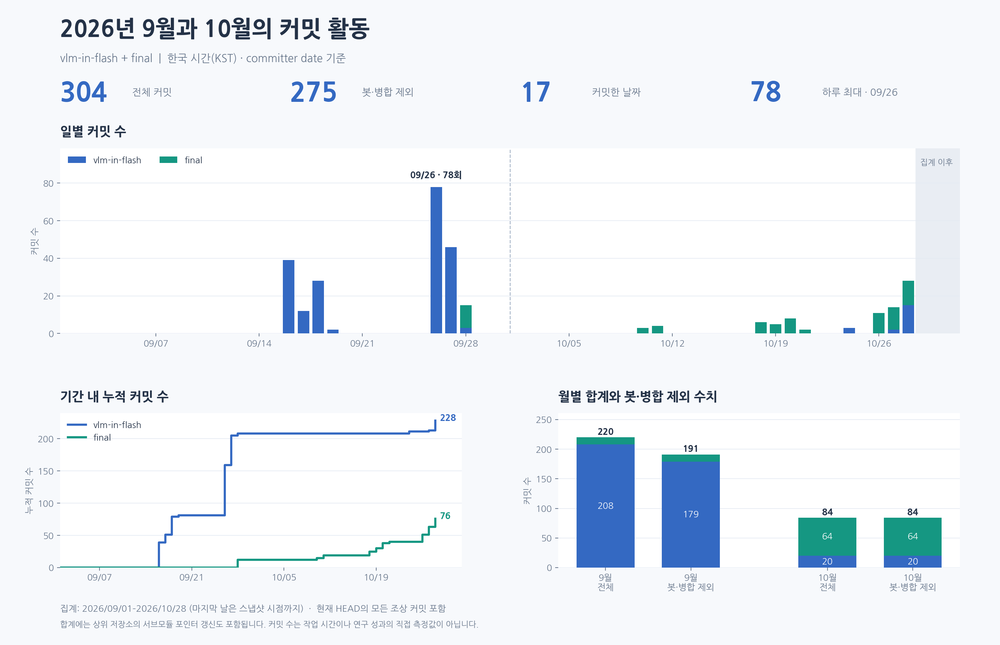
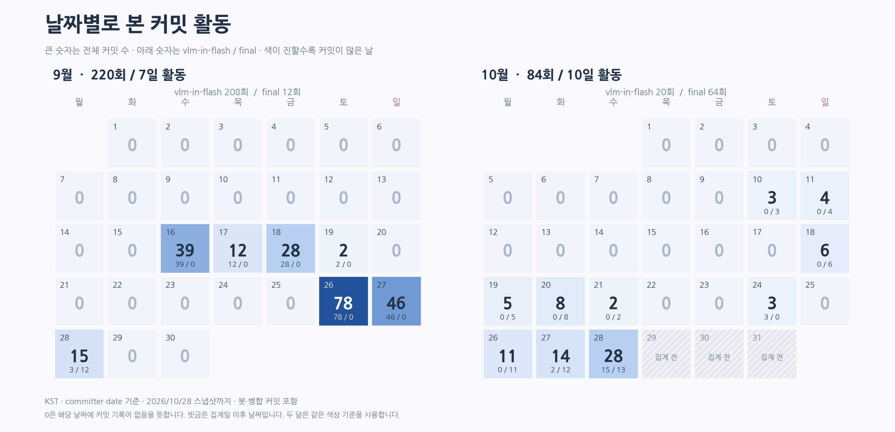

# 2026년 9월과 10월 커밋 활동 분석

`vlm-in-flash`와 `final` 서브모듈의 Git 로그를 한국 시간으로 집계하였다.
분석 범위는 **2026-09-01부터 2026-10-28까지**이며, 마지막 날짜는
**2026-10-28T05:23:44+09:00**에 확보한 Git 기록까지 포함한다.

| 기간 | vlm-in-flash | final | 전체 커밋 | 봇·병합 제외 | 커밋한 날짜 수 |
| --- | ---: | ---: | ---: | ---: | ---: |
| 2026-09 | 208 | 12 | 220 | 191 | 7 |
| 2026-10 | 20 | 64 | 84 | 84 | 10 |
| 합계 | 228 | 76 | 304 | 275 | 17 |

9월에는 본 저장소에, 10월에는 `final`에 커밋 활동이 집중되어 있다.
9월 26–27일에는 합계 124회, 10월 26–28일에는 53회 기록되었다.
10월 커밋 중 `final` 비중은 76.2%이다.
가장 많은 날은 **2026-09-26의 78회**이며,
두 저장소를 합친 최장 연속 커밋 기록은 **4일**이다.
분석 종료일은 2026년 10월 28일이며, 월 전체와 직접 비교할 때 이 범위를 고려해야 한다.

## 그래프



위 그래프는 저장소별 전체 커밋을 표시하고 월별 패널에서 봇·병합 제외 수치도 함께 비교한다.



달력의 큰 숫자는 전체 커밋 수이고, 아래 숫자는 `vlm-in-flash / final` 순서다.
두 달의 색상 범위는 같다. 집계 이후 날짜는 빗금으로 구분하였다.
각 그림은 `figures/`에 PNG, SVG, PDF로 저장되어 있다.

## 집계 방법

- 각 저장소의 스냅샷 HEAD에서 도달 가능한 모든 조상 커밋을 집계하였다.
  다른 브랜치에서만 도달 가능한 기록과 `final` 안의 중첩 서브모듈 기록은 포함하지 않는다.
- Git의 **committer date**를 `Asia/Seoul`로 변환하여 날짜를 정하였다.
  author date와 날짜가 다른 커밋은 1개이며,
  해당 SHA는 `summary.json`, 두 시각은 `data/commits.csv`에 기록하였다.
- 전체에는 병합 16개와 봇 13개가 포함된다.
  봇은 author 또는 committer의 이름·이메일에 `[bot]`이 있는 기록으로 분류하였다.
  `봇·병합 제외`는 두 조건 중 하나라도 해당하면 제외한 수치다.
  AI 도구를 이용해 작성한 사람이름의 커밋을 구분하는 지표는 아니다.
- 같은 저장소 안에서는 SHA당 한 번 집계하고, 활동일은 두 저장소에서 커밋이 하나라도 있는 날짜의 합집합이다.
  두 저장소 합계 304개 중 서로 다른 SHA는 304개다.
- 상위 저장소에서 `final` 포인터를 갱신한 커밋도 별도 기록으로 포함한다.
  합계는 두 저장소의 커밋 객체 수이며, 서로 독립적인 작업 횟수를 뜻하지 않는다.
- 9월의 첫 기록 이전 날짜도 달력상 0회로 표시한다.
  커밋 수는 기록의 빈도이며 작업 시간이나 연구 성과를 직접 측정하지 않는다.

## 재실행

Python 3.10 이상, Git, Matplotlib, 한글 글꼴(NanumGothic 또는 Noto Sans CJK)이 필요하다.
저장소 루트에서 다음 명령으로 **같은 HEAD와 집계 종료일**을 다시 분석한다.

```sh
python exp-after-final/15_commit_activity/analyze_git_activity.py
```

현재 체크아웃의 HEAD를 새로 반영하려면 다음과 같이 실행한다.
이 명령은 이 디렉토리의 스냅샷과 분석 산출물을 덮어쓴다.

```sh
python exp-after-final/15_commit_activity/analyze_git_activity.py --refresh --as-of 2026-10-28
```

Git 기록은 읽기만 하며 fetch, checkout, commit은 실행하지 않는다.

## 파일

- `snapshot.json`: 분석 시점, 날짜 기준, 고정한 두 저장소 HEAD
- `summary.json`: 전체 요약 지표와 월별·저장소별 집계
- `data/commits.csv`: 커밋 SHA, 작성자, 두 시각, 병합·봇 분류, 제목
- `data/daily.csv`: 커밋이 없는 날을 포함한 일별 수치
- `data/monthly.csv`: 저장소별·합산 월별 수치와 활동일 평균
- `analyze_git_activity.py`: 원본 로그 추출, 집계, 그래프 생성 코드

분석한 HEAD:

```text
vlm-in-flash 64cb5277f9b077ed2981acca8c8d8bd7265f7e74
final        5fbf420dcc3e14bc73d1953b90030d4ab47d3efc
```
